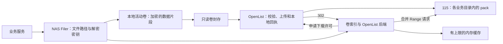

# OpenList / 115 冷存储适配

更新时间：2026-10-15。实现语言为 Go。

此分支新增 `openlist` 卷存储后端，搭配
`ahaduoduoduo/autofilm-openlist` 的 `/seaweedfs/v1` 接口使用。
Backrest 不参与运行。NAS 保持在线并持有业务数据库、Filer 元数据、卷索引和密钥；
115 保存按业务目录分开的不可变 pack。

## 已实现的读写过程



上传时计算完整卷的 SHA-256，OpenList 只有在远程上传及本地回执均成功后才确认。
随后 SeaweedFS 原子保存 `.vif`，切换到远程后端，再删除本地 `.dat`。
上传失败或 `.vif` 保存失败都会保留本地数据；相同内容重试复用 OpenList 已提交回执。

读取通过本地 `.idx` 定位，使用 302 地址下载较大的连续范围。默认一次读取最多 64 MiB，
同一后端的缓存总量默认 256 MiB；读取同一范围的并发请求共用结果。
一个 Volume Server 进程中的所有 OpenList 后端共用下载队列，实际 CDN 下载并发为 1，
即使下载时间超过网关间隔，也不会因其他业务的请求增加下载并发。
不同业务后端有独立缓存，因此总内存上限是各后端缓存配置之和。
HEAD、目录浏览、文件定位及正常卷挂载均不查询 115 列表。

`.vif` 中的远程 key 格式为 `v1.<sha256>.<8字节卷头的hex>`。
卷头包含格式版本等信息，不包含正文或解密密钥；它使重启挂载无需下载所有远程卷。
网关对象 key 仍然只使用 SHA-256。原有 `s3` 等后端的 key 格式不变。

## 本地配置示例

先在 OpenList 配置同名业务空间及其 115 目录 ID。将相应 Token 放入只允许服务用户读取的文件。
`master.toml` 示例：

```toml
[storage.backend.openlist.notes]
enabled = true
endpoint = "http://127.0.0.1:5244/seaweedfs/v1"
space = "notes"
token_file = "/absolute/path/to/notes.token"
read_window_mib = "64"
cache_mib = "256"
max_object_mib = "64"
timeout_seconds = "600"
```

为 `photos`、`files` 添加相应配置段和不同的 Token 文件。
Master 将非秘密配置分发给 Volume Server，**每个相关节点都需要相同绝对路径的 Token 文件**；
不会把 Token 内容加入分发配置。首版按单 NAS 部署。

在单独工作目录准备 `filer.toml`，把元数据保存在 NAS 持久存储：

```toml
[leveldb2]
enabled = true
dir = "/absolute/path/to/metadata"
[filer.options]
metaLog.collection = "filer-meta"
```

开发启动示例：

```bash
weed server -ip=127.0.0.1 -ip.bind=127.0.0.1 -filer \
  -dir=/absolute/path/to/volumes -volume.max=1024 \
  -master.volumeSizeLimitMB=60 -master.telemetry=false \
  -filer.maxMB=4 -volume.fileSizeLimitMB=5 \
  -filer.encryptVolumeData -filer.saveToFilerLimit=0
```

卷目标设置 60 MiB，为最后一个写入片段预留空间；64 MiB 是远端单对象限制，
超过时明确拒绝上传并保留本地文件。生产接入还应限制业务上传并发并观察卷大小。
不要把上游默认的大卷配置直接用于此后端。

**加密必须在写入时开启。** 已有明文卷不会因为启用远程后端自动加密。
通过 S3 写入时同样启用 `-s3.encryptVolumeData`。远程内容按 SeaweedFS 原有数据片段
使用独立随机密钥及 AES-GCM 加密，解密密钥保存在 NAS 的 Filer 元数据中。
文件名和路径通过 Filer 管理。卷格式头、大小等存储结构信息不隐藏。

在 `weed shell` 中配置业务目录：

```text
fs.configure -locationPrefix=/notes/ -collection=notes -volumeGrowthCount=1 -fsync -apply
fs.configure -locationPrefix=/photos/ -collection=photos -volumeGrowthCount=1 -fsync -apply
fs.configure -locationPrefix=/files/ -collection=files -volumeGrowthCount=1 -fsync -apply
```

然后业务使用 Filer HTTP API 上传 JSON、图片和视频。每个业务只增长一个活动卷，
连续写入的相关内容通常处于相同或相邻卷；这是初步时间局部性，不保证笔记及所有附件
始终位于一个 pack。超过单卷的大视频也必然跨卷。

显式封存一个卷：

```text
lock
volume.tier.upload -collection=notes -volumeId=1 -dest=openlist.notes
unlock
```

可以使用现有命令的 `-fullPercent`、`-quietFor` 选择符合条件的卷，当前不自动启动维护任务。
不要对这些远程卷安排频繁 vacuum、全量校验、重新打包或远程目录扫描。
业务 API 的上传成功表示 NAS 接收完成；只有对应卷封存成功才表示远端字节及本地回执已提交。

## 风控与失败行为

- OpenList 按账户限制下载启动间隔，默认 5 秒，返回 `429 Retry-After` 时后端等待后重试。
- 冷却状态的 `503` 直接返回，不在一次读取中持续探测。
- CDN 的 403/405/429 会报告给网关，使共享账户的其他业务也进入持久化冷却。
- 302 跳转由后端显式处理，不向 CDN 发送 OpenList Bearer Token。
- 后端验证 `206`、Content-Range 和实际字节数；完整恢复卷时还验证 SHA-256。
- 远程删除是逻辑删除，不立即物理删除 115 对象；失败上传可能留下孤立尝试。
  两者均等待保留期和检查点感知的离线回收机制。
- 本地缓存不命中时允许多下载一些字节，优先减少下载次数。

OpenList 的 302 许可控制的是合规客户端的请求次数，不能阻止拿到地址的客户端自行重复请求。
后端缓存和网关账户间隔共同控制本实现的读取行为。

## 恢复与当前范围

需要一致备份：业务数据库、Filer 元数据及密钥、全部 `.idx/.vif`、OpenList 回执数据库和配置。
`.dat` 中未封存的内容还在 NAS，不能当作已云端保存。仅拥有 115 pack 无法恢复业务。
当前网关提供本地回执导出/导入；协调的加密云端检查点尚未实现。

此版本提供可运行的存储适配基础。以下功能尚未纳入接口：

- 业务事务与附件引用的一致性协议，以及统一的远端持久化状态 API；
- 基于笔记关系、相册时间顺序的显式亲和调度；自动封存和缓存容量管理界面；
- 普通客户端获取细粒度读计划，直接从 115 下载并解密的 SDK；
- 加密元数据云端检查点、完整灾难恢复和物理空间回收。

当前远端数据流是 **115 → NAS SeaweedFS 后端 → 业务客户端**，与客户端直接读取 115 的最终方案不同。
OpenList 已返回 302，但本次消费 302 的是 SeaweedFS 后端。
现有 Filer / S3 接口可以接业务，业务仍需由 NAS 服务控制身份与权限。

## 本地验证与构建

```bash
cd ../autofilm-openlist
go build -o /tmp/openlist-lab ./cmd/seaweedfs-lab
cd ../seaweedfs
go build -o /tmp/weed ./weed
python3 test/openlist/integration.py --weed /tmp/weed --gateway /tmp/openlist-lab
```

测试使用真实 SeaweedFS 进程、实际网关和 SQLite，115 驱动由磁盘模拟器替代。
不访问 NAS、真实 OpenList 服务或真实 115。
`--keep` 保留独立临时目录方便检查；测试始终停止自己启动的进程。

验证内容：45 个文件和三个业务目录、密文无测试明文、并发读取合并成三次 CDN 请求、
原始内容与 Range 一致、目录查询为零、下载间隔、Token 不发送至 CDN、失败上传保留本地、
上传回执丢失重试、`.vif` 提交失败后复用远端回执、两端重启恢复及 405 冷却持久化。

本地可以构建 ARM。此 fork 的 GitHub 工作流仅构建 linux/amd64 测试二进制；
原上游工作流移至 `.github/upstream-workflows` 作为参考，不执行发布和多架构任务。
