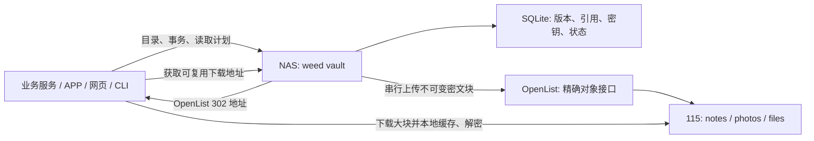

# Vault：APP、网页和 CLI 共用的存储接入

更新：2026-10-15。服务端使用 Go，接入协议是 HTTP/JSON 和标准 AES-256-GCM，不限制业务语言。

## 运行方式

`weed vault` 是这个 fork 的业务入口。它复用 SeaweedFS 的 superblock/needle 卷格式和 OpenList 后端，直接维护自己的 SQLite 目录；无需另外启动 Master、Filer 或 Volume Server。原有 Filer/S3 冷存储适配仍然是独立入口。两者的数据目录和元数据不能混用。



NAS 必须在线，只有一个 Vault 进程拥有写入权，目录文件锁防止重复启动。空间隔离通过独立业务令牌和 OpenList 目录配置实现。

### 立即运行本地示例

从两个仓库构建二进制；示例只连接磁盘模拟器：

```bash
cd ../autofilm-openlist
go build -o build/openlist-lab ./cmd/seaweedfs-lab
cd ../seaweedfs
go build -o build/weed ./weed
python3 examples/vault/local.py \
  --weed build/weed \
  --openlist-lab ../autofilm-openlist/build/openlist-lab \
  --dir /tmp/my-vault-demo
```

打开 `http://127.0.0.1:19400`，业务空间填写 `notes`，令牌读取 `/tmp/my-vault-demo/notes.token`。页面支持多文件提交、正文/图片/视频预览、读取状态和手动云端同步。提交完成后内容保存在 NAS，点击“立即同步至云端”可以上传未满部分。停止脚本会停止两个服务，数据保留在指定目录。

CLI 使用 Node 22+，无需 npm 依赖：

```bash
export VAULT_URL=http://127.0.0.1:19400
export VAULT_SPACE=notes
export VAULT_TOKEN_FILE=/tmp/my-vault-demo/notes.token
node examples/vault/cli.mjs put article article.json note-001
node examples/vault/cli.mjs list
node examples/vault/cli.mjs get article downloaded.json
# 范围采用 [START, END)，输出为解密后的明文字节
node examples/vault/cli.mjs get video excerpt.bin 1048576 2097152
```

实际部署使用 [配置示例](../examples/vault/config.json)，执行 `weed vault -config=/etc/vault/config.json`。OpenList 需要本 fork 的对应版本和同名空间。公网入口配置 HTTPS；浏览器 WebCrypto 需要安全上下文，localhost 可以直接开发。

每个业务令牌、全局管理员令牌使用至少 32 字符的独立随机值。恢复密钥文件内容为 32 个随机字节的标准 Base64（例如 `openssl rand -base64 32`）。OpenList 网关令牌与业务令牌分开；客户端只拿业务令牌。

## 接入模式

| 接入者 | 使用方式 |
|---|---|
| 业务服务器 | 任意语言调用 HTTP；保存稳定对象 ID、当前 revision 和业务关系 |
| 浏览器、浏览器插件 | ES module + WebCrypto；使用业务服务器签发的短期令牌 |
| 原生 APP | 调用同一 HTTP 协议，用系统 AES-GCM 实现解密；全块缓存可使用磁盘 |
| CLI | 提供 Node 流式 CLI；Python 示例演示独立实现 |

浏览器直接导入：

```js
import { VaultClient } from 'https://vault.example.com/sdk/client.mjs';
const vault = new VaultClient({
  url: 'https://vault.example.com', space: 'notes', token: shortLivedToken
});
const batch = await vault.putBatch({
  idempotencyKey: 'capture-20261015-001',
  group: 'note-001', sortKey: '2026-10-15T08:30:00Z',
  objects: [
    { id: 'note-001-json', blob: new Blob([JSON.stringify(article)],
      {type: 'application/json'}), ifVersion: 0 },
    { id: 'note-001-image', blob: imageFile, ifVersion: 0 }
  ]
});
// 本地事务已提交，可立即读取。默认持续聚合到满包。
// 业务明确要求立即云端保存时，显式同步当前业务再等待：
await vault.flush();
await vault.waitRemote(batch.id);
const articleBytes = await vault.read('note-001-json');
for await (const bytes of vault.stream('video', {start: 0, end: 8 * 1024 * 1024})) {
  await destination.write(bytes);
}
```

`read()` 将结果整体放入内存，适用于正文和图片；大视频、备份文件使用 `stream()`。上传通过 Blob 的 4 MiB 切片和增量 SHA-256 处理，CLI 使用文件 Blob，不需要将整个文件读入内存。Python 示例位于 [client.py](../examples/vault/client.py)，解密依赖 `cryptography`。

业务主令牌能够签发短期令牌：

```http
POST /v1/spaces/notes/tokens
Authorization: Bearer <notes master token>
Content-Type: application/json

{"subject":"browser-user-42","scope":"write","ttl_seconds":3600}
```

`read` 只允许读取；`write` 包含读取和写入。短期令牌不能继续签发令牌。权限范围是整个业务空间，应用自己的用户/笔记权限仍由业务服务器处理；需要更细的用户隔离时使用独立空间或业务服务代理授权。

## 写入、一致性和关系打包

1. 创建批次，声明每个对象的 ID、长度、SHA-256、内容类型和 `if_version`。
2. 以 `Upload-Offset` 上传最多 4 MiB 的片段。服务端先同步文件，再提交进度；重启后查询进度续传。
3. 提交时校验全部内容摘要和全部版本条件。在一个 SQLite 事务里同时切换正文和附件引用。
4. 后台在每个业务内按 `group + sort_key` 排列批次，容量足够时封存上传；未满部分继续保存在 NAS，重启后接着聚合。不同关联组可以共享业务包。
5. OpenList 返回持久化回执后，更新远端状态并删除本地正文、附件暂存和 pack。

创建对象使用 `if_version: 0`；更新必须填写当前数字 revision。任一对象版本冲突返回 409，整批不会部分提交。相同幂等键和相同清单返回原批次；相同键配不同清单返回 409。对象 ID 限制为 1–128 个字母、数字、下划线、点或短横线，首字符为字母或数字。

分组建议：笔记的一次提交包含 JSON 和附件；同一本笔记本可以共用 group。相册使用日期/相册 ID 作为 group，拍摄时间作为 sort_key。一个提交批次能够放进一个 pack 时保持同块；不同批次的相同 group 优先相邻，过大的对象连续分块。封存时只排序当时已经提交的内容，后到的数据不会重新改写历史块。

默认每块上限 64 MiB，每个加密片段明文上限 4 MiB。接近上限（预留一个片段的空间），或者无法容纳下一个关联批次时，当前包可以封存。格式头和认证信息计入块上限，因此实际有效载荷略少于 64 MiB。相互独立业务永不混装。重写对象生成新版本，旧版本和旧块保留；此版本没有自动物理垃圾回收。

### 零散写入与手动同步

`seal_seconds` 默认 **0**：关闭时间触发，不会因为等待 60 秒或服务重启而上传未满包。大文件已填满的部分可先上传，最后未满部分继续暂存；完成整批远端确认前保留该批次的原始暂存文件，供 NAS 读取与失败恢复。

```http
POST /v1/spaces/notes/flush
Authorization: Bearer <notes write token>
```

返回 `202` 和 `{"batches":["待同步批次 ID"]}`。请求持久化后由后台执行，只影响该业务；重启后继续。JavaScript 使用 `vault.flush()`，Python 使用 `client.flush()`；需要确认完成时，等待返回批次达到 `remote`。CLI 的 `put` 保存到 NAS 后返回，`sync` 主动封存并等待云端确认。手动完整检查点也会封存所有业务的未满部分。

只有显式配置正数 `seal_seconds` 才启用最长暂存时间。单独调用 `waitRemote()` 只观察状态，不会强制封存。暂存达到 `staging_mib` 上限时返回 507，由业务决定手动同步或稍后重试，不隐式上传小包。

| 状态 | 含义与本地占用 |
|---|---|
| `uploading` | 未完成事务，对象尚未对其他读者可见 |
| `accepted` | 本地事务已提交，暂存数据可立即读取；部分满包可能已上传，整批仍未完成 |
| `packed` | 已封存加密，正在等待远端持久化确认 |
| `remote` | 数据块和 OpenList 回执已确认，可删除本地数据副本 |
| 对象 `checkpoint` 非空 | 此版本已包含在指定云端检查点中 |

读取已经提交但尚未封存的内容使用 NAS 暂存数据；封存后返回密文块读取计划。对象版本不可变，读者获取计划后即使对象被更新，也能完成该版本的读取。

`staging_mib` 默认 8192，按尚未远端确认的上传声明大小预留额度；超额返回 507。加密打包期间需要额外空间，部署时至少预留约两倍暂存额度及检查点空间。失败上传保持本地数据并延迟重试。未提交上传默认 24 小时过期，已提交数据不自动丢弃。

## 读取协议与 115 请求频率

`GET /v1/spaces/{space}/objects/{id}/plan` 返回对象版本、pack 摘要和片段表。片段字段：

| 字段 | 含义 |
|---|---|
| `plain_offset`, `plain_size` | 对象明文中的位置与长度 |
| `pack`, `cipher_offset`, `cipher_size` | 所属 pack 及其中密文字节位置 |
| `key` | 当前片段的 32 字节 AES 密钥，标准 Base64 |
| `aad` | AES-GCM 认证上下文原始字节，标准 Base64 |

每个片段的密文是 `12-byte nonce || ciphertext || 16-byte tag`，AES-256-GCM，AAD 必须使用计划中提供的字节。明文范围 `[a,b)` 选择与之相交的片段，验证并解密整个片段后再裁剪。服务端仅返回所请求对象的密钥，即使同一个 pack 还包含其他对象。

下载过程：

1. 客户端先查本地密文缓存，命中则无需读取会话或云请求。
2. `POST .../packs/{pack}/lease` 创建独立读取会话，返回 OpenList 的可复用 URL。已有其他下载不阻止创建会话。API 路径保留 `lease` 名称，但不再表示全局单下载许可。
3. 使用 `Range: bytes=0-{pack.size-1}` 获取大块并缓存，减少逐个小对象读取。有效 URL 可以重复下载、范围读取，也可以与其他 URL 同时下载；同一授权会话允许重复或并发的密文中转。
4. 按返回间隔调用 `POST .../leases/{id}/renew` 延长 NAS 会话；它不申请新 URL，也不延长 CDN URL 的有效期。完成后调用 `POST .../leases/{id}/complete`，JSON `{"status":206}` 或实际失败状态码。结束会话保留 OpenList URL 缓存。
5. 验证长度和 SHA-256，缓存密文；根据计划解密所需片段。

### 链接失效与 API 请求调度

OpenList 持久化 URL 缓存，重启继续复用。115 未给出明确过期时间时不猜测 TTL，`url_cached_until` 为 0，表示有效期未知。下载实际返回 401/403/404/410 后，客户端完成旧会话并报告状态，再申请新会话。服务端报告的是该会话的确切旧 URL；并发失败报告不会重复失效新 URL，多个客户端共享一次刷新结果。

只有新 URL 申请消耗 `read_interval_ms` 额度，默认间隔 5 秒；客户端收到 `429 Retry-After` 时等待。首次 403 允许刷新；新链接仍返回 403 则进入账户冷却，成功读取清除连续失败计数。405/429 直接报告风控并返回错误。一次读取最多刷新两次，JS/Python 默认等待上限每次 600 秒，Go 后端由 `timeout_seconds` 限制。冷却超过等待上限时返回错误，由调用方稍后重试。不能把网络中断或 CORS 失败一律视为 URL 过期。

上传初始化、下载地址申请、离线任务提交等 115 API 继续共用既有账户限速器；上传同时遵守已有上传队列。有效 URL 的文件传输可以并行。目录浏览、查询版本、获取计划、缓存读取都不查询 115 列表。

浏览器 SDK 使用 256 MiB 有界缓存，IndexedDB 持久保存密文，Web Locks 合并同源多标签页对同块的下载；不同设备拥有各自缓存。浏览器 CORS 不可用时，`auto` 使用 NAS 密文中转，仍复用同一个缓存 URL；若中转发现链接失效，则按上述协议刷新。解密始终在客户端。`direct` 强制直读，`proxy` 强制密文中转。中转只接受已签发会话中的固定 URL。

2026-10-16 的真实 115 测试确认：当前精确下载 API 的签名绑定申请时的 User-Agent。
读取会话的可选 `download_user_agent` 字段说明这个要求；空字符串也必须保留。
Node、Python、Go 和原生 APP 将它设置到 CDN 请求，OpenList 的业务 Token 不发送给 CDN。
浏览器不能修改这个请求头，因此 `auto` 在发起 CDN 请求前选择 NAS 密文中转，继续复用
同一下载链接并在浏览器解密；这种情况下 `direct` 返回明确错误。不会为了浏览器差异
按每一种 User-Agent 重新申请 115 链接，也不会把请求头不匹配误报为 URL 过期。

同一轮真实测试还观察到：并发读取有效链接时，部分请求返回 `403` 和 JSON
`message: "115 pmt 3-2"`，另外的请求仍可成功。SDK 将这一明确响应视为暂时繁忙，
保留原 URL，按 5、10、15 秒最多重试三次；不触发新链接申请或账户冷却。
NAS 中转将其标记为 `503`、`Retry-After: 5`、`X-Vault-CDN-Busy: 1`。
其他拒绝响应继续按链接失效/风控协议处理，避免把所有 403 都当成可重试的繁忙。

## 统一云端检查点与恢复

默认每小时检查是否存在尚未备份的完整云端版本，有变化才生成自动检查点。自动检查点不封存未满部分；只保存已经完整远端确认的版本。若某对象的新版本仍在 NAS，恢复自动检查点时得到它之前的云端版本；只有本地版本的对象不包含在其中。

手动创建完整检查点会主动封存所有已提交内容，使用全局管理员令牌调用：

```http
POST /v1/checkpoints
Authorization: Bearer <server admin token>
```

返回作业 ID。通过 `GET /v1/checkpoints` 获取最近 20 个作业，`GET /v1/checkpoints/{id}` 查询结果，`GET /v1/checkpoints/{id}/ticket` 下载恢复票据。

检查点短暂停止变更请求，返回 `503 Retry-After: 3`，保存一致的 SQLite 快照和精确对象回执。手动检查点等待全部已提交数据取得远端回执；自动检查点只选取完整云端版本，并重建对应的对象引用，保持 NAS 上的待上传内容不变。未提交上传排除在快照外。元数据、密钥和回执一起加密后分块上传。读取目录和已提交内容仍可使用。SDK 自动重试短暂维护响应；账户长时间冷却会返回错误供业务展示。

只有检查点所有部分上传成功并完成本地状态提交后，作业才标记 `complete`。票据中的载荷使用 Base64 保持签名字节稳定；票据本身不包含恢复密钥。服务端也将票据保存到 `dir/checkpoints/{id}.json`。

**完整恢复需要：最近成功检查点的票据、恢复密钥、业务/OpenList 配置及凭据。** 请把票据和恢复密钥保存在 NAS 之外。仅有云端密文块、没有票据和恢复密钥，不能完成免列表恢复。自动检查点不代表其他设备已经下载了最新票据。

```bash
# config.json 中 dir 必须指向新的空目录；space 和远端目录映射保持一致
weed vault.restore -config=/etc/vault/restore.json -ticket=/safe/vault-checkpoint.json
weed vault -config=/etc/vault/restore.json
```

恢复首先验证票据签名，然后利用精确定位回执导入恢复检查点片段；下载并解密数据库与全部 pack 回执，检查 SQLite 完整性，最后安装数据库。即使 Vault 和 OpenList 的两个本地数据库都丢失，也无需枚举 115 目录。相同回执重复导入是幂等操作；不一致回执不会覆盖现有数据。

检查点涵盖 Vault 管理的目录、对象、附件和引用。外部应用的 PostgreSQL/SQLite 数据库需要先导出，并作为同一业务提交的对象保存；Vault 不会自动获取另一个应用的事务快照。

## 接口速查

所有 `/v1` 接口均要求 `Authorization: Bearer`。错误响应为 `{"error":"..."}`。

| 方法与路径 | 请求 / 结果 |
|---|---|
| `GET /health` | 服务探测 |
| `GET /v1/spaces/{s}/status` | 本地/封存/远端批次数及后台错误 |
| `POST /v1/spaces/{s}/flush` | 手动封存当前业务的未满部分；202 返回待同步 batches |
| `POST /v1/spaces/{s}/tokens` | 签发短期业务令牌 |
| `POST /v1/spaces/{s}/batches` | `{idempotency_key,group,sort_key,objects:[{id,size,sha256,content_type,if_version,metadata}]}` → `{id}` |
| `GET /v1/spaces/{s}/batches/{b}` | 状态及每个对象已上传字节数 |
| `PUT /v1/spaces/{s}/batches/{b}/objects/{o}` | 二进制片段，`Upload-Offset`；204 返回新进度；409 返回应续传位置 |
| `POST .../batches/{b}/commit` | 校验摘要与版本，原子提交；409 冲突；422 摘要不符 |
| `DELETE .../batches/{b}` | 放弃未提交上传 |
| `GET .../objects?after={id}` | 按 ID 分页，100 条及 next 游标，全部本地查询 |
| `GET .../objects/{o}` | 当前对象元数据；`?version={version-id}` 读取历史版本 |
| `DELETE .../objects/{o}` | `If-Match: <revision>`；创建墓碑版本 |
| `GET .../objects/{o}/plan` | 标准加密读取计划；支持 version 参数 |
| `POST .../packs/{p}/lease` | 独立读取会话和可复用 OpenList 地址 |
| `POST .../leases/{l}/renew` | 延长当前 NAS 读取会话 |
| `POST .../leases/{l}/complete` | 结束会话并报告下载状态 |
| `GET .../leases/{l}/bytes` | 可重复的 NAS 密文中转 |
| `/v1/checkpoints` | 管理员创建/查询检查点 |

## 验证

[本地场景验证结果](vault-validation.md)。

`test/vault/sparse.py` 另外覆盖默认不定时封存、32 个独立关联组聚合、70 MiB 大文件尾部保留、旧数据库升级、自动检查点保留暂存内容、按云端旧版本恢复、CLI 手动同步及终止后恢复。

`test/vault/scenarios.py` 启动真实 Vault 和 OpenList 网关进程，唯一隔离层为磁盘 115 模拟器。包括 512 MiB 单文件、实际 JPEG/MP4、六个并发生产者、Python/Node/浏览器同时读取、两个浏览器标签页、断电式终止、上传失败、冷却、跨块解密和两个目录数据库完全丢失后的恢复。截图与结构化计数写入 `build/vault-test-results/`。

```bash
python3 -m pip install cryptography
npm ci --prefix test/vault
cd test/vault && npx playwright install chromium && cd ../..
python3 test/vault/scenarios.py --weed build/weed \
  --openlist-lab ../autofilm-openlist/build/openlist-lab
```

测试需要 ffmpeg、Python 3.11+、Node 22+，以及约 4 GiB 可用临时空间。GitHub 仅执行 linux/amd64 构建。本地可使用 ARM；真实 NAS 和 115 的生产部署不属于本轮测试。
